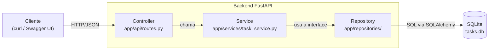

# Arquitetura da Micro-API de Tarefas

## Prompt usado para gerar o diagrama (padrão CO-STAR)

- **Contexto:** Estou projetando uma Micro-API de gerenciamento de tarefas em Python 3.13 com FastAPI. Os dados são persistidos em SQLite via SQLAlchemy. Não há frontend: a API é consumida por curl e pela documentação interativa (Swagger UI).
- **Objetivo:** Crie um diagrama de componentes mostrando a interação entre cliente, API e banco de dados. O backend deve ter as camadas controller, service e repository.
- **Estilo:** Diagrama de componentes simples, com setas de comunicação identificadas.
- **Tonalidade:** Técnica e objetiva.
- **Audiência:** Desenvolvedores que vão ler e manter o projeto.
- **Resposta:** Forneça apenas o código Mermaid.

## Diagrama de componentes



## Responsabilidades das camadas

| Camada | Arquivo | Responsabilidade |
|---|---|---|
| Controller | `app/api/routes.py` | Recebe a requisição HTTP, valida a entrada e devolve a resposta |
| Service | `app/services/task_service.py` | Regras de negócio e erro de tarefa não encontrada |
| Interface | `app/repositories/interface.py` | Contrato `ITaskRepository` que o service usa |
| Repository | `app/repositories/task_repository.py` | Implementação do contrato com SQLAlchemy (CRUD) |
| Schemas | `app/models/schemas.py` | Modelos Pydantic (entrada e saída da API) |
| Modelo de banco | `app/models/db_models.py` | Tabela `tasks` (SQLAlchemy) |
| Banco | `app/database.py` | Conexão e sessão com o SQLite |
| Entrada | `app/main.py` | Cria a aplicação, as tabelas e trata o erro 404 |

## Decisões de design

- **Schemas separados do modelo de banco:** a API não expõe diretamente a tabela, o que evita misturar o formato da API com o do banco.
- **Service depende de interface:** o service conhece `ITaskRepository`, não o SQLAlchemy. Isso permite trocar o banco e testar o service com um repository falso, sem banco de dados.
- **Erro 404 em um só lugar:** o service lança `TaskNotFoundError` e o `main.py` converte em resposta 404, sem `try/except` repetido em cada rota.

## Estrutura de pastas

```text
task-api/
├── app/
│   ├── __init__.py
│   ├── main.py
│   ├── database.py
│   ├── api/
│   │   ├── __init__.py
│   │   └── routes.py
│   ├── services/
│   │   ├── __init__.py
│   │   └── task_service.py
│   ├── repositories/
│   │   ├── __init__.py
│   │   ├── interface.py
│   │   └── task_repository.py
│   └── models/
│       ├── __init__.py
│       ├── schemas.py
│       └── db_models.py
├── tests/
│   ├── __init__.py
│   ├── test_api.py
│   ├── test_task_repository.py
│   └── test_task_service.py
├── docs/
│   ├── architecture.md
│   └── prompts.md
├── .gitignore
├── LICENSE
├── Makefile
├── requirements.txt
└── README.md
```

## Endpoints

| Método | Rota | Descrição |
|---|---|---|
| POST | `/tasks` | Cria uma tarefa |
| GET | `/tasks` | Lista tarefas (filtro opcional por `status`) |
| GET | `/tasks/{id}` | Busca uma tarefa |
| PUT | `/tasks/{id}` | Atualiza uma tarefa |
| DELETE | `/tasks/{id}` | Remove uma tarefa |