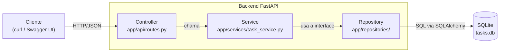

# Task API

Micro-API RESTful para gerenciamento de tarefas (criar, listar, buscar, atualizar e remover), desenvolvida como miniprojeto da pós-graduação em *Engenharia de Software: Automação e Inovação com Inteligência Artificial Generativa*. O foco do trabalho é aplicar IA generativa em várias etapas do ciclo de vida do software (arquitetura, código, testes, refatoração e documentação), sempre com revisão humana.

## Funcionalidades

- CRUD completo de tarefas
- Filtro de tarefas por status (concluída ou pendente)
- Validação de dados (título de 3 a 100 caracteres)
- Persistência em SQLite
- Documentação interativa automática (Swagger UI)
- 22 testes automatizados

## Tecnologias

- **Linguagem:** Python 3.13
- **API:** FastAPI e Pydantic
- **Banco de dados:** SQLite com SQLAlchemy 2
- **Testes:** pytest (com `httpx2` para o cliente de teste)
- **Formatação:** black
- **IA e assistentes usados:** Claude (Anthropic), em chat, com prompts estruturados no padrão CO-STAR. Veja [docs/prompts.md](docs/prompts.md).

## Como configurar e rodar

Pré-requisitos: Python 3.13 e Git.

```bash
git clone https://github.com/SEU_USUARIO/task-api.git
cd task-api

python -m venv .venv
# Windows (PowerShell): .venv\Scripts\activate
# Mac/Linux/Git Bash:   source .venv/bin/activate

python -m pip install -r requirements.txt
uvicorn app.main:app --reload
```

A API fica em `http://127.0.0.1:8000` e a documentação interativa em `http://127.0.0.1:8000/docs`. O arquivo `tasks.db` é criado automaticamente na primeira execução.

Se você tiver o `make` instalado, também pode usar `make install`, `make run`, `make test` e `make format`.

## Endpoints

| Método | Rota | Descrição | Respostas |
|---|---|---|---|
| POST | `/tasks` | Cria uma tarefa | 201, 422 |
| GET | `/tasks` | Lista tarefas (filtro opcional `?status=true` ou `?status=false`) | 200 |
| GET | `/tasks/{id}` | Busca uma tarefa | 200, 404, 422 |
| PUT | `/tasks/{id}` | Atualiza os campos informados | 200, 404, 422 |
| DELETE | `/tasks/{id}` | Remove uma tarefa | 204, 404 |

## Exemplos de uso

Os exemplos abaixo funcionam no Linux, no macOS e no Git Bash. No PowerShell, use a documentação interativa em `/docs`.

Criar uma tarefa:

```bash
curl -X POST http://127.0.0.1:8000/tasks \
  -H "Content-Type: application/json" \
  -d '{"title": "Estudar FastAPI", "description": "Ler a documentação"}'
```

Listar todas as tarefas, ou só as concluídas:

```bash
curl http://127.0.0.1:8000/tasks
curl "http://127.0.0.1:8000/tasks?status=true"
```

Buscar, atualizar e remover (troque `ID_DA_TAREFA` pelo `id` devolvido na criação):

```bash
curl http://127.0.0.1:8000/tasks/ID_DA_TAREFA

curl -X PUT http://127.0.0.1:8000/tasks/ID_DA_TAREFA \
  -H "Content-Type: application/json" \
  -d '{"status": true}'

curl -X DELETE http://127.0.0.1:8000/tasks/ID_DA_TAREFA
```

Exemplo de resposta:

```json
{
  "title": "Estudar FastAPI",
  "description": "Ler a documentação",
  "status": false,
  "id": "3f1c2d6e-8a4b-4c7e-9d10-5b2a7e6f9c01",
  "created_at": "2026-10-18T14:30:00"
}
```

## Testes

```bash
python -m pytest -v
```

São 22 testes, organizados por camada:

- `tests/test_task_repository.py`: repository com banco SQLite em memória
- `tests/test_task_service.py`: service com um repository falso, sem banco
- `tests/test_api.py`: endpoints HTTP com banco em memória

Os testes não criam nem alteram o arquivo `tasks.db`.

## Arquitetura

A aplicação segue a divisão em camadas controller, service e repository:



O service depende da interface `ITaskRepository`, e não da implementação com SQLAlchemy. Isso permite trocar o banco e testar o service sem banco de dados. Mais detalhes em [docs/architecture.md](docs/architecture.md).

Estrutura de pastas:

```text
task-api/
├── app/
│   ├── main.py                  # entrada da aplicação
│   ├── database.py              # conexão com o SQLite
│   ├── api/routes.py            # endpoints (controller)
│   ├── services/task_service.py # regras de negócio
│   ├── repositories/            # interface e implementação do acesso a dados
│   └── models/                  # schemas Pydantic e tabela SQLAlchemy
├── tests/
├── docs/
├── Makefile
├── requirements.txt
└── README.md
```

## Como a IA acelerou este projeto

O projeto foi construído em etapas, cada uma com um prompt estruturado (contexto, objetivo, estilo e formato de resposta) e uma revisão do resultado antes do commit. Os prompts estão em [docs/prompts.md](docs/prompts.md).

**Onde a IA ajudou mais**

- **Código repetitivo:** modelos Pydantic, modelo SQLAlchemy, repository e rotas CRUD saíram prontos de prompts curtos.
- **Testes:** os 22 testes (repository, service e API) foram gerados a partir de uma lista de cenários, incluindo casos de erro (404 e 422).
- **Arquitetura e documentação:** o diagrama Mermaid, a estrutura de pastas, o `.gitignore` e o esqueleto do README vieram de prompts.
- **Tempo economizado:** [PREENCHER: estimativa de quanto tempo levou cada etapa com IA, comparada com fazer manualmente].

**Decisões de arquitetura influenciadas pela IA**

- Separar os schemas Pydantic (o que a API recebe e devolve) do modelo da tabela, para não misturar a API com o banco.
- Introduzir a interface `ITaskRepository` na refatoração (Repository Pattern), o que permitiu testar o service com um repository falso.
- Centralizar o tratamento de "tarefa não encontrada" em um único ponto (`main.py`), em vez de repetir `try/except` em cada rota.

**Lições aprendidas (limitações da IA e papel da revisão humana)**

- **Código plausível, mas com problemas sutis.** O primeiro repository tinha um método chamado `list`, que esconde a função nativa do Python. A revisão na etapa de refatoração pegou o problema, e ele virou `list_all`. Os testes que já existiam garantiram que a mudança não quebrou nada.
- **Exemplos desatualizados.** O material do curso usa sintaxe antiga em alguns pontos (`class Config` no Pydantic, `datetime.utcnow`, versões fixas de bibliotecas). Foi preciso pedir explicitamente a sintaxe moderna no prompt e conferir com as versões realmente instaladas.
- **O ecossistema muda.** Ao rodar os testes apareceu um aviso de depreciação: o `TestClient` do Starlette passou a preferir o `httpx2` no lugar do `httpx`. A IA não havia previsto isso, e a solução veio de ler o aviso e a documentação atual.
- **Código gerado só vale depois de executado.** A IA não rodou os testes no meu ambiente. Cada etapa só foi commitada depois de eu rodar `pytest` localmente.
- **Conferir antes de commitar.** O `git status` antes de cada commit evitou que arquivos `__pycache__` e ambientes virtuais fossem para o repositório.

## Limitações e próximos passos

O que o projeto ainda não faz:

- **Não há autenticação nem autorização:** qualquer cliente pode ler e alterar qualquer tarefa.
- **Não há paginação:** `GET /tasks` devolve todas as tarefas de uma vez.
- **Filtros limitados:** só existe filtro por status. Faltam busca por texto, ordenação e filtro por data.
- **Não é possível limpar a descrição:** o `PUT` ignora campos `null`, então uma descrição já preenchida só pode ser trocada, não apagada.
- **Sem migrações de banco:** as tabelas são criadas com `create_all`. Mudanças no modelo exigiriam apagar o banco ou usar uma ferramenta como o Alembic.
- **Fuso horário:** o SQLite não guarda fuso, então `created_at` volta sem a informação de UTC.
- **Service fino:** hoje ele quase só repassa chamadas ao repository, porque ainda não há regras de negócio complexas.
- **Só SQLite:** PostgreSQL seria mais adequado para uso real.

Próximos passos possíveis: autenticação com JWT, paginação e filtros avançados, migrações com Alembic, execução em contêiner (Docker), integração contínua com GitHub Actions e uma interface web.

## Créditos e licença

Desenvolvido por SEU NOME como miniprojeto da pós-graduação em Engenharia de Software: Automação e Inovação com IA Generativa, com apoio de IA generativa.

Distribuído sob a licença MIT. Veja o arquivo [LICENSE](LICENSE).
